# Evidencias de la práctica U4P3

**Alumno:** Rene Alejandro Coronado Cordova
**Grupo:** DSM 4-1
**Fecha:** 08/11/2026

## Repositorio y despliegue

- Repositorio: https://github.com/coronadocordovar-png/u4p3-practica1-coronado-cordova-rene-alejandro
- Aplicación: https://u4p3-practica1-coronado-cordova-rene.onrender.com
- Commit de implementación: 60d12cd

### 01. Repositorio GitHub
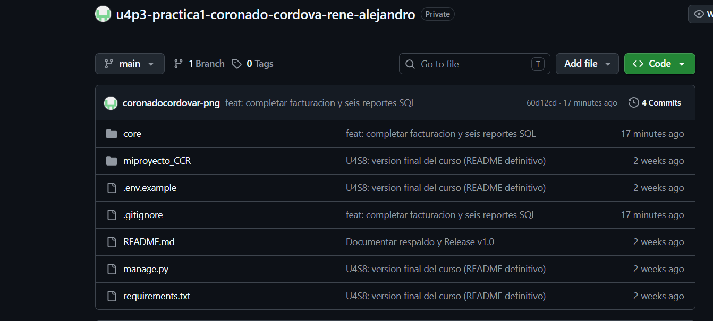

### 02. Despliegue en Render
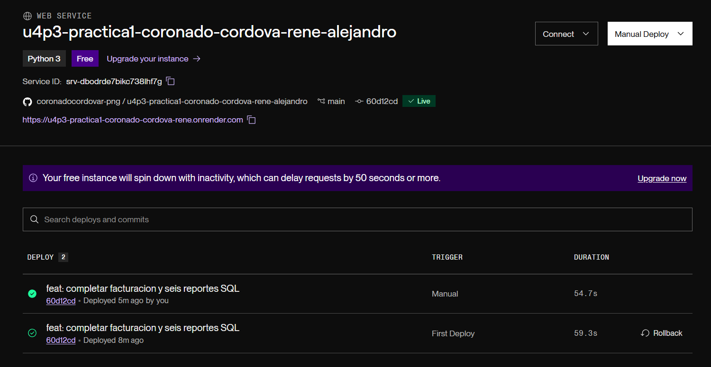

## Categorías y servicios

### 03. Listado de categorías
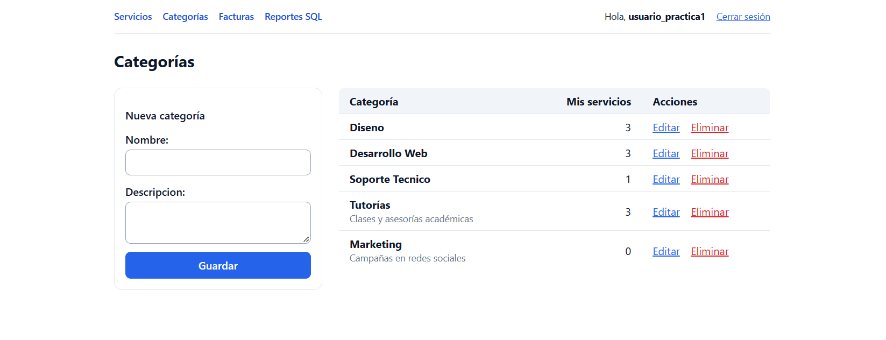

### 04. Servicios - página 1
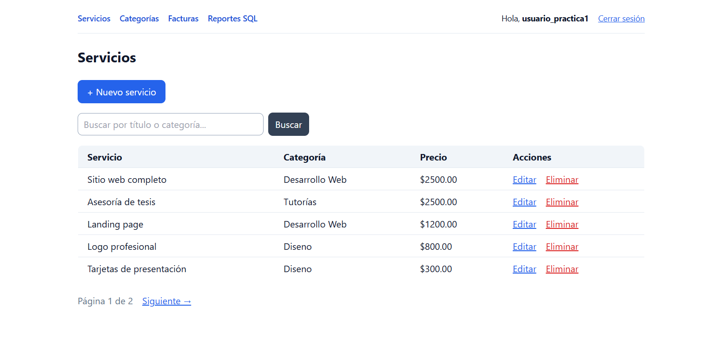

### 05. Servicios - página 2
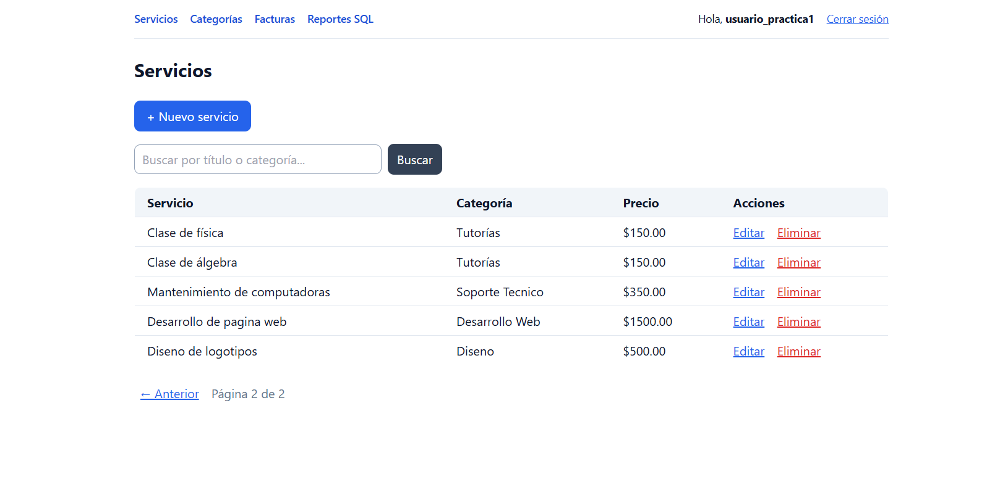

## Facturación

### 06. Listado de facturas
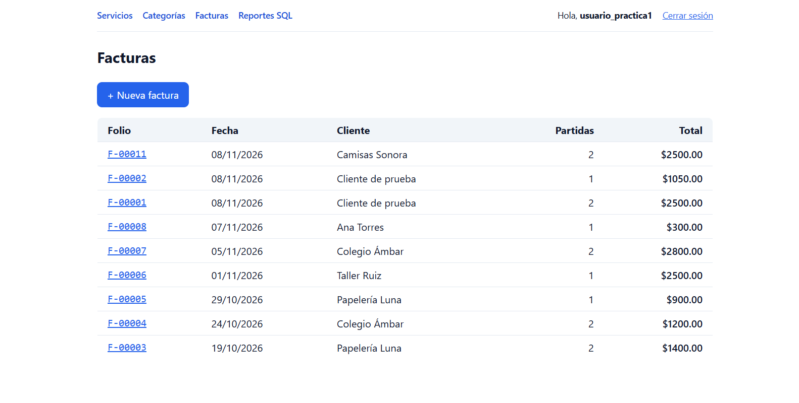

### 07. Detalle de factura
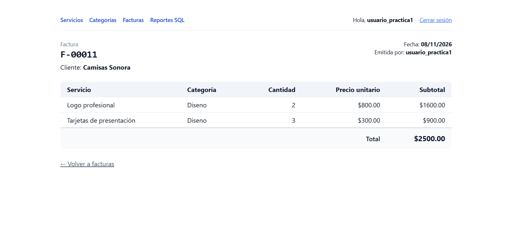

## Reportes SQL

La aplicación incluye seis reportes SQL con consulta de resultados
y visualización del plan de ejecución mediante EXPLAIN.

### 08. Menú de reportes
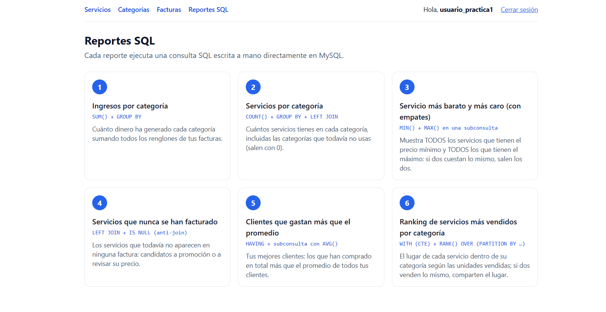

### 09. Resultados del reporte SQL
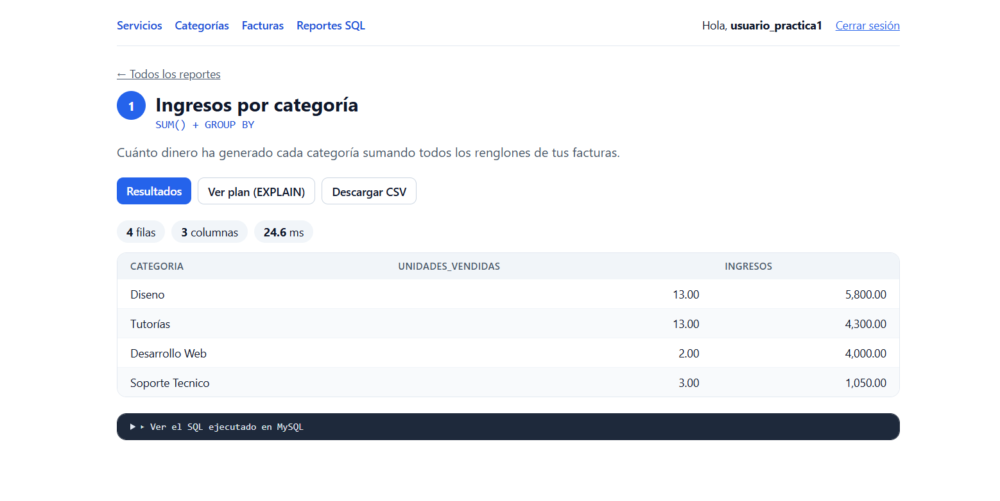

### 10. EXPLAIN - primera parte
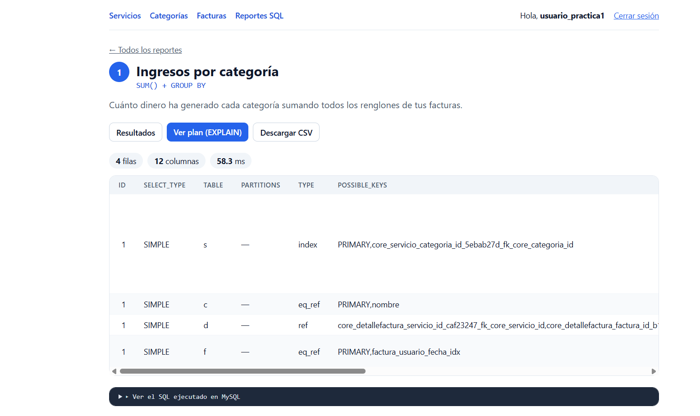

### 11. EXPLAIN - segunda parte
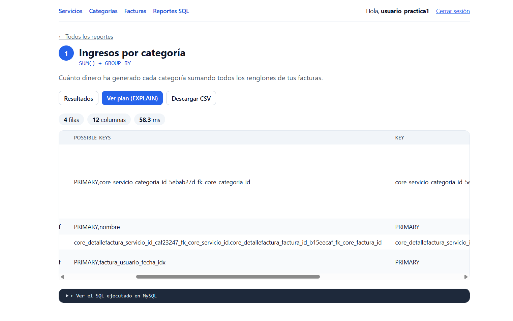

### 12. EXPLAIN - tercera parte
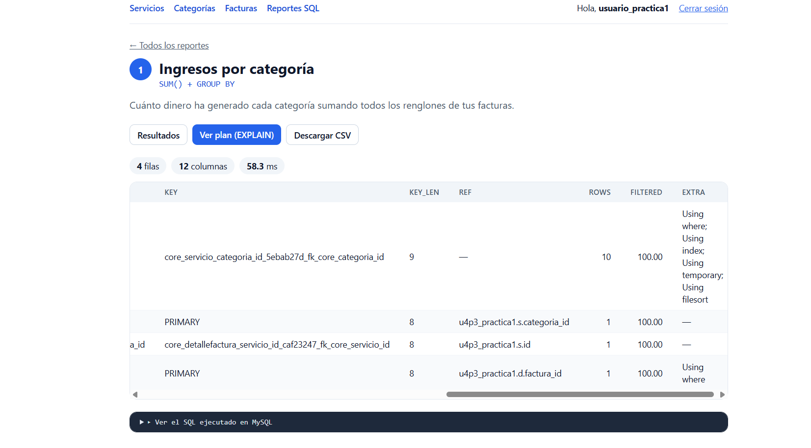

## Verificación

Se realizaron pruebas de navegación de categorías, servicios,
facturación y reportes SQL, incluyendo la consulta de planes
de ejecución EXPLAIN.

Las capturas están disponibles en la carpeta evidencias/.
